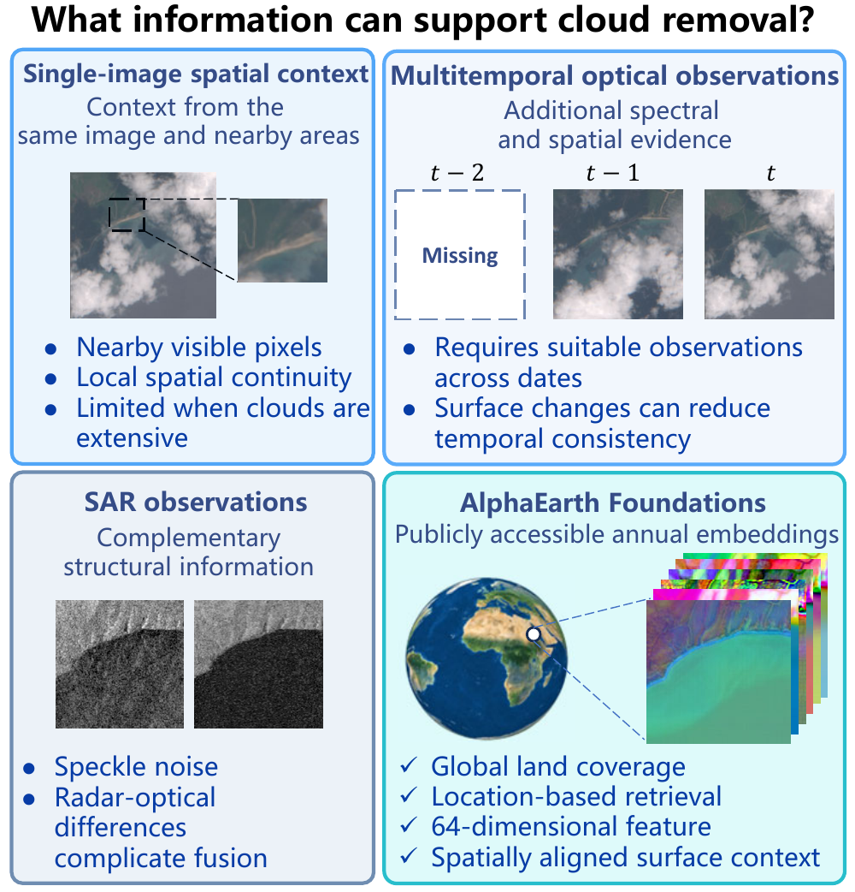
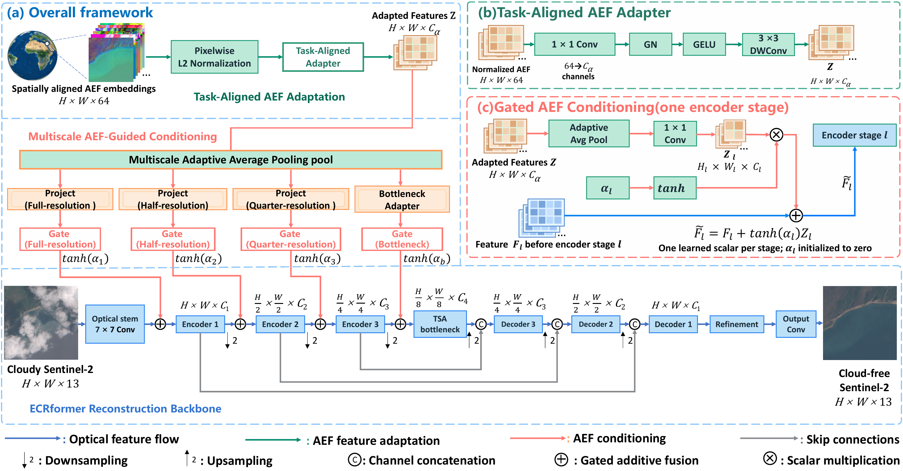
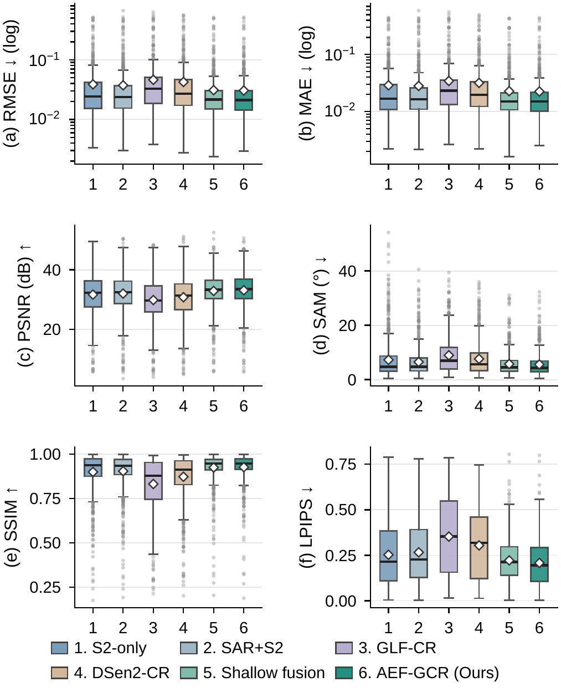
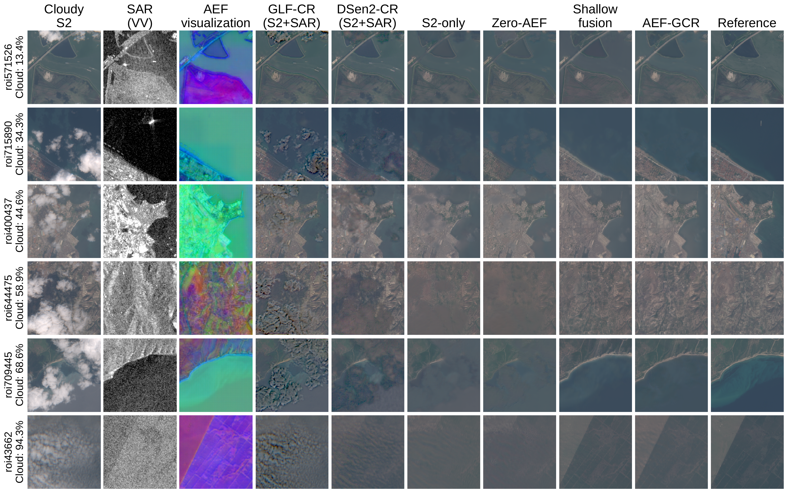

# AEF-GCR

**AEF-GCR: AlphaEarth Foundations Embedding-Guided Cloud Removal from Single Optical Images**

Long Lin, Zheng Zhang, Hongyi Li, Zhao Wang, Keli Shi, and Hong-An Wei.

Research implementation of single-image cloud removal guided by AlphaEarth
Foundations (AEF) embeddings, using ECRformer as the reconstruction backbone.
This repository is being prepared for release; it does not claim an accepted
publication or provide a checkpoint download that is not yet available.

## Motivation

<p align="center">
  
</p>

AEF provides annual surface context to complement the visible information in
a cloudy optical observation. Colored AEF panels are pseudocolor embedding
visualizations, not optical images.

## Method



- Input: one 13-band cloudy Sentinel-2 image and a spatially aligned
  64-channel AEF embedding. The proposed model does not take SAR as input.
- A pixelwise unit-norm embedding is adapted to 16 reconstruction-oriented
  channels using a pointwise convolution, GN, GELU, and depthwise convolution.
- Three encoder gates and one bottleneck gate inject multiscale AEF features.
  The independent scalar gate parameters are initialized to zero.
- Output: a 13-band reconstructed Sentinel-2 image.
- ECRformer provides the three-stage encoder/decoder backbone and auxiliary
  feature supervision. These components are credited to the original work.

## Repository scope

Included: paper illustrations, model code, AllClear loading, paper configurations,
training and evaluation, checkpoint conversion, fixed split identifiers, metric aggregation,
and small CPU tests. No raw imagery, model weights, experiment directories,
credentials, third-party paper PDFs, or internal server notes are included.

GLF-CR and DSen2-CR were external local adaptations in the paper comparison;
their source trees and trained checkpoints are **not** included here. This
repository alone is not a complete reproduction package for those two methods.

## Installation

The development environment used Python 3.10.20, PyTorch 2.5.1+cu124,
torchvision 0.20.1+cu124, and PyTorch Lightning 2.5.6. Direct dependencies are
pinned in `requirements.txt`; this is not a lockfile for every transitive package.

```bash
conda create -n aef-gcr python=3.10 -y
conda activate aef-gcr
python -m pip install torch==2.5.1 torchvision==0.20.1 \
  --index-url https://download.pytorch.org/whl/cu124
python -m pip install -r requirements.txt
python -m pip check
```

Use a PyTorch build appropriate for your CUDA driver or a CPU build for small
tests. A GPU is recommended for actual training and full-image evaluation.

## Data preparation

Obtain AllClear imagery and the original validation manifest from the dataset
authors. Obtain spatially aligned AEF embeddings separately; neither dataset
is redistributed here. The AEF data product is documented at
https://developers.google.com/earth-engine/datasets/catalog/GOOGLE_SATELLITE_EMBEDDING_V1_ANNUAL.

```text
datasets/
├── Allclear/
│   ├── metadata/datasets/val_tx12_s2-s1_100pct.json
│   └── val/                         # original manifest-relative image paths
└── val_aef_downloads_cropped/
    ├── roi709445_2023_utm_cropped.tif
    └── ...                         # one aligned 64-channel raster per ROI
```

Configure your own paths from the repository root:

```bash
export ECRFORMER_DATASETS_ROOT=/path/to/datasets
```

Optional independent overrides are `ECRFORMER_ALLCLEAR_ROOT` and
`ECRFORMER_AEF_ROOT` (or `ECRFORMER_VAL_AEF_ROOT`). `.env.example` illustrates
the names but is **not automatically loaded**. With no override, paths resolve
under this repository's `datasets/` directory, not a developer's server directory.

Cloudy optical observations are selected nearest to the reference date.
Optical values are clipped to [0, 10000] and divided by 10000. AEF vectors are
normalized pixelwise across 64 channels with epsilon 1e-6, without componentwise
clipping. Zero-AEF is zeroed after normalization. The SAR baseline uses nearest
available S1 VV/VH, clipped to [-25, 0]/[-35, 0] dB and scaled to [0, 1].
Automatic download/repair is disabled by default: missing or corrupt files must
be prepared separately. The code will not silently repair or replace your data.

## Paper protocol — important

The paper uses an **internal ROI-disjoint 80:20 split of the AllClear validation
branch**, with seed 42. It does not use the official AllClear train/test benchmark
protocol. The release defaults below reproduce that internal protocol, not the
development project's separate test-to-val experiment.

| Partition | Samples | ROIs |
|---|---:|---:|
| Optical/AEF training | 4,510 | 787 |
| Optical/AEF validation | 1,123 | 197 |
| SAR-available training subset | 3,394 | 626 |
| Common SAR-available validation subset | 763 | 145 |

ROIs are assigned using their original manifest order **before** filtering S1
availability. Do not sort or recreate the manifest and assume the seed alone
preserves membership. `splits/allclear_val_roi80_seed42.json` records the exact
sample/ROI identifiers and manifest SHA-256, without raster paths or imagery.

Verify the original manifest before training or evaluation:

```bash
python scripts/verify_protocol.py \
  --manifest "$ECRFORMER_DATASETS_ROOT/Allclear/metadata/datasets/val_tx12_s2-s1_100pct.json"
```

This checks metadata only and reads no rasters. If you use an independent
AllClear-root override, adjust the command's manifest path accordingly.

## Training

Check GPU availability and occupancy yourself before starting a run:

```bash
nvidia-smi
```

After choosing an idle physical GPU (replace `0` if needed):

```bash
CUDA_VISIBLE_DEVICES=0 python train.py \
  --config ecrformer_aef --name paper_seed42 --gpu 0 --no-resume
```

Physical batch size is 4 with gradient accumulation 4 (effective batch 16),
random 128×128 training crops, FP32, AdamW (learning rate 4e-4, weight decay
1e-3), at most 200 epochs, early stopping patience 10, and gradient clipping
0.5. ReduceLROnPlateau (factor 0.1, patience 5) monitors validation reconstruction
loss. The output loss is 0.9 L1 + 0.1 (1−SSIM); auxiliary encoder and decoder
weights are 0.05 each. The AEF adapter uses 16 channels and GN with 4 groups.

`--no-resume` starts a new experiment; omitting it enables automatic resume
from the latest matching experiment, which can select `last.ckpt`.

| Configuration | Purpose |
|---|---|
| `ecrformer_aef` | Proposed AEF-GCR |
| `ecrformer_s2only` | Optical-only ECRformer, no AEF reading/branch |
| `ecrformer_aef_shallow_fusion` | Separate optical/AEF shallow stems and concatenation |
| `ecrformer_aef_zero_legacy` | Complete AEF-GCR architecture with zeroed AEF input |
| `ecrformer_sar_legacy` | SAR+S2 ECRformer, fixed original ROI assignment |

Use the same command with the appropriate `--config` and a distinct run name.
Original SEN12MS-CR loaders/configurations are retained for compatibility but
are not the AEF-GCR paper protocol.

## Evaluation

**Trained weights are not bundled and no public download is configured yet.**
Use your own checkpoint or a future verified download. Specify the checkpoint
explicitly; automatic latest-checkpoint selection is not necessarily the paper's
best validation checkpoint. Only load checkpoints from trusted sources.

First run a small preview (not a reportable benchmark score):

```bash
CUDA_VISIBLE_DEVICES=0 python test.py \
  --config ecrformer_aef --legacy-val-holdout \
  --ckpt-path /path/to/aef_gcr.ckpt \
  --output-dir results/aef_gcr_preview --max-samples 5 \
  --batch-size 1 --num-workers 0 --gpu 0 --export-format png
```

Then evaluate all 1,123 validation samples:

```bash
CUDA_VISIBLE_DEVICES=0 python test.py \
  --config ecrformer_aef --legacy-val-holdout \
  --ckpt-path /path/to/aef_gcr.ckpt \
  --output-dir results/aef_gcr_full1123 \
  --batch-size 4 --num-workers 2 --gpu 0 --export-format none
```

The historical `--legacy-val-holdout` flag is retained for compatibility; these
release configurations already default to the same single-branch holdout.
Do not pass `--split val` when evaluating a paper checkpoint: that would bypass
the holdout and include its training ROIs. Remove `--max-samples` for full scores.

RMSE, MAE, PSNR, SAM, and SSIM use all 13 optical bands. LPIPS uses VGG on
B4/B3/B2 reflectance, mapped to [-1, 1], not the sRGB visualization. Scores are
arithmetic means of per-image full-256×256 metrics. SAM is in degrees and PSNR
in dB. PNGs use B4/B3/B2 with fixed [0, 0.9] scaling followed by sRGB; there is
no per-image contrast stretching. Display settings do not change metrics.

Aggregate on the fixed full or common validation IDs:

```bash
python scripts/summarize_metrics.py \
  --metrics results/aef_gcr_full1123/metrics.csv --partition validation

python scripts/summarize_metrics.py \
  --metrics results/aef_gcr_full1123/metrics.csv --partition sar_validation
```

The latter selects the same 763 samples as the SAR baselines; it does not
equalize their training sets or objectives. For the SAR configuration, evaluate
its 763-sample holdout with its own compatible checkpoint and summarize with
`--partition sar_validation`.

### Reported reference results

These are recorded paper results, not scores recomputed during release preparation.

| Configuration | Validation N | PSNR (dB) ↑ | SSIM ↑ |
|---|---:|---:|---:|
| S2-only | 1,123 | 31.790 | 0.9051 |
| Zero-AEF | 1,123 | 31.741 | 0.9031 |
| Shallow fusion | 1,123 | 32.751 | 0.9261 |
| AEF-GCR | 1,123 | 33.067 | 0.9282 |
| AEF-GCR, common subset | 763 | 33.154 | 0.9258 |

The validation holdout was also used for checkpoint selection; it is not an
independent test set. ECRformer variants select by validation reconstruction
loss except the recorded final-checkpoint Zero-AEF control. External GLF-CR
and DSen2-CR adaptations used validation MAE. Adaptation and conditioning
change together, so these comparisons do not isolate their individual effects.

### Per-image score distributions

<p align="center">
  
</p>

Boxes show the interquartile range; lines and diamonds denote medians and
means. RMSE and MAE use logarithmic axes. Arrows indicate the preferred metric
direction.

### Qualitative comparison



ROI identifiers and input cloud fractions are shown on the left. SAR and AEF
columns visualize auxiliary inputs, not optical predictions. All optical
panels share the same display transform. Click the image to inspect details.

## CPU checks and upload review

The current stage is file preparation, not a completed reproducibility
validation. The following commands are retained for a separate verification
phase; checkpoint inference and full benchmark reproduction remain pending.

```bash
python -m unittest discover -s tests -v
python scripts/check_release.py
```

The tests use synthetic inputs and do not download weights or read AllClear.
The upload check examines Git candidates without staging, committing, pushing,
or reading Git credentials. Manual security and license review are still required.

## Attribution, citation, and release status

This work builds on [ECRformer](https://github.com/zzaiyan/ECRformer).
ECRformer now provides a GNU GPL version 3 license, verified on 2026-10-16.
This modified work follows GPL version 3; see [LICENSE](LICENSE).
Original third-party notices remain applicable. See
[THIRD_PARTY_NOTICES.md](THIRD_PARTY_NOTICES.md) for the modification record,
the retained Restormer MIT notice, and remaining DRSformer/SSIM notice review.
This private preparation snapshot is not a claim that every embedded
third-party licensing question has been resolved.

```bibtex
@article{zhang2026ecrformer,
  title={{ECRformer}: An efficient cloud removal transformer with semantic-decoupled learning for multimodal satellite imagery},
  author={Zhang, Zaiyan and Li, Jie and Liang, Yuanqi and Yan, Jining and Xiao, Yi and Su, Xin and Yuan, Qiangqiang},
  journal={ISPRS Journal of Photogrammetry and Remote Sensing},
  volume={237},
  pages={323--338},
  year={2026},
  doi={10.1016/j.isprsjprs.2026.04.009}
}
```

A final citation for AEF-GCR will be added when bibliographic information is
available. Public checkpoint links and a paper release tag are intentionally
not fabricated in this preparation copy.
